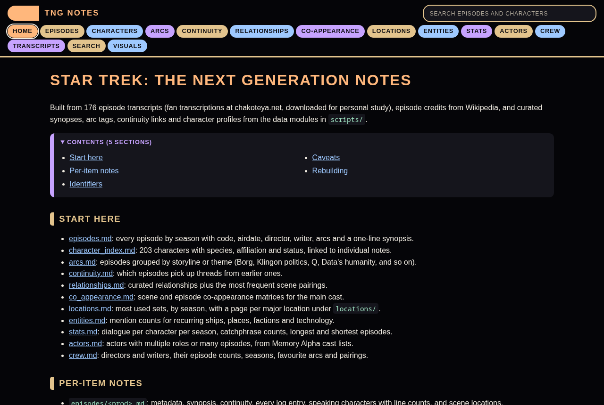
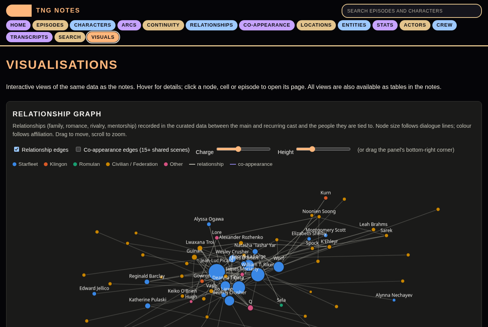
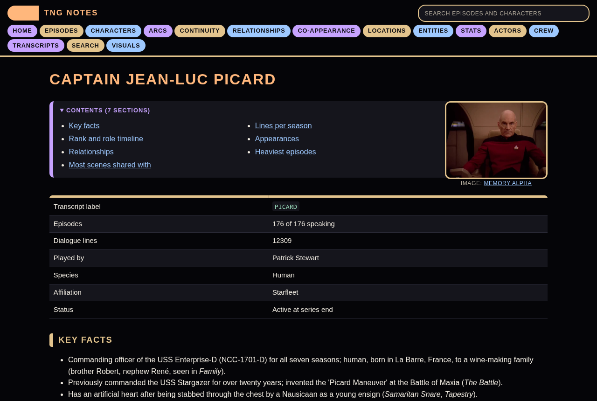

# Star Trek: The Next Generation notes

A study companion for all 176 episodes of *Star Trek: The Next Generation*, built from the episode transcripts, Wikipedia and Memory Alpha. It is a set of generated Markdown notes plus a static website for browsing them.

**Browse the site:** https://gahrae.github.io/star_trek_tng/

[](https://gahrae.github.io/star_trek_tng/)

## What is in it

- **Episodes.** Every episode by season with code, airdate, director, writer, story arcs, a synopsis, log entries, speaking characters and scene locations.
- **Characters.** 203 characters with a profile, key facts, rank timeline, relationships, most shared scenes, lines per season and a full appearance list. Portraits and episode screenshots come from Memory Alpha.
- **Transcripts.** All 176 transcripts reformatted with speaker names linked to the character pages, scene headings linked to location pages, and a tool to follow one speaker through an episode.
- **Search.** A quick search over episodes and characters on every page, and a full-text search of all dialogue with phrase and speaker filters that links straight to the line in the transcript.
- **Arcs and continuity.** Episodes grouped by storyline (Borg, Klingon politics, Q, Data's humanity and so on) and a map of which episodes pick up threads from earlier ones.
- **Relationships and co-appearance.** Curated relationships, the most frequent scene pairings and co-appearance matrices for the main cast.
- **Locations, entities, stats.** Most used sets, mention counts for recurring ships, places and factions, dialogue per character per season, catchphrase counts, stardate anomalies.
- **Actors and crew.** Actors with multiple roles, directors and writers with their episode counts, seasons and pairings.
- **Visuals.** An interactive relationship graph, a co-appearance heatmap, dialogue per season, a stardate chart and an arc timeline.

| Visuals | Character page |
|---|---|
|  |  |

## Layout

```
data/      cleaned transcripts (text/), raw downloads (raw/, ma/), portraits (images/), episode screenshots (episode_images/)
           and the structured JSON: episodes, metadata, characters, scenes, presence, cast
notes/     generated Markdown notes; start at notes/README.md
scripts/   fetchers, the curated data modules and the builders
site/      generated website (not committed; built by ./build.sh and by the Pages workflow)
docs/      screenshots for this README
```

The curated content (synopses, arc tags, continuity links, character profiles, relationships) lives in `scripts/curated_episodes.py` and `scripts/curated_characters.py`. Everything else is derived from the transcripts and the fetched data.

## Building it yourself

Requires Python 3 and the packages in `requirements.txt` (only `markdown` is needed to build the site from the committed data).

```
pip install -r requirements.txt
./build.sh            # regenerate notes/ and site/ from the data on disk, then run the checks
./build.sh --fetch    # also run the fetchers first (they skip anything already downloaded)
python3 -m http.server -d site 8000   # then open http://localhost:8000
```

The individual steps are `scripts/fetch_transcripts.py`, `fetch_metadata.py`, `fetch_cast.py`, `fetch_images.py`, `build_notes.py`, `build_site.py` and `check.py`. `data/provenance.json` records when and from where each data set was fetched.

The site uses only relative links, so it works from any folder or sub-path. The workflow in `.github/workflows/pages.yml` rebuilds and deploys it to GitHub Pages on every push to `main`.

## How the data was made

**Extracted from the transcripts by code:** dialogue, line counts, appearances, scenes and locations, log entries, shared scenes and co-appearance, mention counts for recurring ships, places and technology, catchphrase counts, and the full-text search. Silent appearances are found by matching names in stage directions, so they are approximate.

**Taken from other sources:**
- Transcripts come from [Chrissie's Transcripts Site](http://www.chakoteya.net/NextGen/episodes.htm) (chakoteya.net), downloaded for personal study.
- Episode numbering, airdates, directors and writers come from Wikipedia.
- Cast lists, portraits and episode screenshots come from [Memory Alpha](https://memory-alpha.fandom.com/) (CC BY-NC). Cast credits are matched to speakers by name, and only about half match. Portraits are picked by an automated search, so a few may show the wrong person. Episode screenshots are the lead image of each episode's Memory Alpha page, checked by eye.

**Where AI was used:** the project was built with Claude, an AI assistant, working from my direction and review.
- **Code:** the scripts, the site and the build were written with Claude's help.
- **From the transcripts:** each episode's synopsis and arc tags were written by reading the full transcript.
- **Written from general knowledge, then checked:** character key facts, profiles, relationships and guest descriptions were checked against Memory Alpha and the episode transcripts, and corrected where they didn't match.
- **Continuity links:** each link between episodes was checked against both transcripts, and links with no explicit connection in the text were removed.
- **Not checked:** the choice of which entities and catchphrases to count. Portraits are picked by an automated search, so a few may be wrong. Check anything you rely on.

Appearance counts are based on dialogue. Speaker labels follow the transcriber's spelling, with a few aliases merged.

## Licence

This is an unofficial fan project, not affiliated with or endorsed by Paramount. *Star Trek* and all related marks and characters are the property of Paramount.

**Code and original work:** the scripts, the site code and the analysis written for this project are released under the MIT licence (see `LICENSE`).

**Other people's content:** the transcripts, cast data, portraits and screenshots were collected from other sites and belong to their owners. They are not covered by the MIT licence. They are included for study and commentary, with credit to the source. The owner of Chrissie's Transcripts Site has kindly agreed to this project keeping its pages. See [CONTENT.md](CONTENT.md) for where each item came from and its terms, and check the original source before reusing any of it.

If you own something here and want it removed, get in touch and I will take it down.
